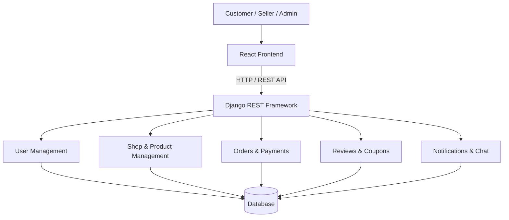

# DIU Startup — Full-Stack E-Commerce Platform

A modern full-stack e-commerce platform built with **React, Vite, Django REST Framework, and PostgreSQL/SQLite**. The system is designed to provide a structured digital commerce experience with dedicated workflows for customers, sellers, and administrators.

---

## Table of Contents

- [Overview](#overview)
- [Core Features](#core-features)
- [Technology Stack](#technology-stack)
- [System Architecture](#system-architecture)
- [Project Structure](#project-structure)
- [Prerequisites](#prerequisites)
- [Installation & Setup](#installation--setup)
- [Environment Configuration](#environment-configuration)
- [Database Migration & Seeding](#database-migration--seeding)
- [Running the Application](#running-the-application)
- [API Documentation](#api-documentation)
- [Development Credentials](#development-credentials)
- [Available Services](#available-services)
- [Troubleshooting](#troubleshooting)
- [Security Considerations](#security-considerations)
- [Contributing](#contributing)
- [License](#license)

---

## Overview

**DIU Startup** is a full-stack e-commerce application developed to facilitate online commerce through a multi-role platform.

The application follows a decoupled architecture, separating the React frontend from the Django REST API backend. This approach improves maintainability, scalability, and the ability to extend individual components independently.

The platform organizes its functionality into dedicated modules for user management, shops, products, orders, payments, reviews, coupons, notifications, and chat.

### Key Objectives

- Provide a centralized platform for online commerce.
- Support multiple user roles and business workflows.
- Maintain a modular and maintainable backend architecture.
- Deliver a responsive and interactive frontend experience.
- Expose RESTful APIs for frontend-backend communication.
- Support both lightweight local development and relational database configurations.

---

## Core Features

The application is organized around the following functional modules:

| Module | Description |
|---|---|
| User Management | User registration and account management |
| Shop Management | Dedicated shop and seller management |
| Product Management | Product-related operations |
| Order Management | Order processing and management |
| Payment Management | Payment-related operations |
| Reviews | Customer review management |
| Coupons | Discount and coupon management |
| Banners | Promotional banner management |
| Notifications | Application notification management |
| Chat | Communication-related functionality |

*Note: Feature availability and permissions depend on the implemented application workflows and user roles.*

---

## Technology Stack

The project uses a modern frontend-backend technology stack.

### Frontend

- **React** — Component-based UI development
- **Vite** — Frontend development and build tooling
- **JavaScript** — Application logic
- **npm** — Dependency management

### Backend

- **Python 3.10+** — Backend programming language
- **Django** — Backend web framework
- **Django REST Framework** — REST API development

### Database

- **SQLite** — Default local development database
- **PostgreSQL** — Alternative relational database configuration

### Development Tools

- Git & GitHub
- Python Virtual Environment
- npm
- Swagger / OpenAPI API Documentation

---

## System Architecture

The application follows a decoupled frontend-backend architecture.



### Architecture Components

**Presentation Layer**
- React-based user interface.
- Component-driven frontend architecture.
- Vite development and production build environment.

**Application Layer**
- Django REST Framework API.
- Modular application structure.
- Business logic and API request handling.

**Data Layer**
- SQLite for default development.
- PostgreSQL as an alternative database backend.

---

## Project Structure

```text
DIU-Startup/
│
├── backend/
│   ├── users/
│   ├── shops/
│   ├── products/
│   ├── orders/
│   ├── payments/
│   ├── reviews/
│   ├── coupons/
│   ├── banners/
│   ├── notifications/
│   ├── chats/
│   │
│   ├── manage.py
│   ├── requirements.txt
│   ├── seed.py
│   └── .env
│
├── frontend_react/
│   ├── public/
│   ├── src/
│   ├── package.json
│   └── vite.config.js
│
└── README.md
```

*The structure above highlights the primary application modules. Individual files and additional directories may vary.*

---

## Prerequisites

Ensure the following software is installed before setting up the project.

| Software | Minimum Version |
|---|---|
| Python | 3.10+ |
| Node.js | 18+ |
| npm | Compatible with installed Node.js |
| Git | Latest stable version |
| PostgreSQL | Optional |

Verify your installation:

```bash
python --version
node --version
npm --version
git --version
```

---

## Installation & Setup

### 1. Clone the Repository

```bash
git clone https://github.com/nbr233/DIU-Startup.git

cd DIU-Startup
```

### 2. Backend Configuration

Navigate to the backend directory:

```bash
cd backend
```

Create a Python virtual environment:

**Windows (PowerShell)**

```powershell
python -m venv venv

.\venv\Scripts\Activate.ps1
```

**macOS / Linux**

```bash
python3 -m venv venv

source venv/bin/activate
```

Install backend dependencies:

```bash
pip install -r requirements.txt
```

### 3. Configure Environment Variables

Create a `.env` file inside the `backend/` directory.

```env
SECRET_KEY=your-secure-django-secret-key
DEBUG=True
ALLOWED_HOSTS=localhost,127.0.0.1

# Database Configuration
DB_ENGINE=sqlite
DB_NAME=diu_startup
DB_USER=postgres
DB_PASSWORD=your_database_password
DB_HOST=localhost
DB_PORT=5432
```

**Database Configuration**

For default SQLite development, keep:

```env
DB_ENGINE=sqlite
```

For PostgreSQL, configure the database settings according to your backend configuration:

```env
DB_ENGINE=postgresql
DB_NAME=diu_startup
DB_USER=postgres
DB_PASSWORD=your_database_password
DB_HOST=localhost
DB_PORT=5432
```

Ensure the PostgreSQL database exists before running migrations.

*Important: Environment variable names and supported database engine values must match the project's Django settings implementation.*

### 4. Database Migration

Generate migrations for the application modules:

```bash
python manage.py makemigrations users shops products orders payments reviews coupons banners notifications chats
```

Apply database migrations:

```bash
python manage.py migrate
```

### 5. Seed Initial Data

Run the seed script to initialize the development database with sample data and predefined administrative accounts:

```bash
python seed.py
```

The seed script is intended for local development and testing.

### 6. Start the Backend Server

```bash
python manage.py runserver 8000
```

Backend API:

`http://127.0.0.1:8000/`

Swagger API Documentation:

`http://127.0.0.1:8000/api/docs/`

---

## Frontend Setup

Open a new terminal and navigate to the project root:

```bash
cd DIU-Startup/frontend_react
```

Install frontend dependencies:

```bash
npm install
```

Start the Vite development server:

```bash
npm run dev
```

Frontend application:

`http://localhost:5173/`

---

## Running the Application

The frontend and backend must run simultaneously during local development.

| Service | Command | Local URL |
|---|---|---|
| Backend | `python manage.py runserver 8000` | http://127.0.0.1:8000 |
| Frontend | `npm run dev` | http://localhost:5173 |
| Swagger | Backend service | http://127.0.0.1:8000/api/docs/ |

---

## API Documentation

The backend provides a RESTful API developed using Django REST Framework.

Interactive API documentation is available through Swagger.

**Swagger UI:**

http://127.0.0.1:8000/api/docs/

Use the documentation to explore available API endpoints, inspect request and response schemas, and test supported API operations.

---

## Development Credentials

The seed script provides the following predefined development accounts.

| Role | Email / Username | Password |
|---|---|---|
| Super Admin | `superadmin@diustartup.com` | `superadmin123` |
| Seller / Shop Owner | `seller@diustartup.com` | `seller123` |
| Customer | Register through the application | User-defined |

**Security Notice:** These credentials are for local development and demonstration purposes only. Never use predefined development credentials in a production environment.

---

## Available Services

| Service | Address |
|---|---|
| Frontend Application | `http://localhost:5173/` |
| Backend API | `http://127.0.0.1:8000/` |
| Swagger Documentation | `http://127.0.0.1:8000/api/docs/` |

---

## Troubleshooting

### Python Virtual Environment Activation Error

If PowerShell blocks virtual environment activation, execute:

```powershell
Set-ExecutionPolicy -Scope Process -ExecutionPolicy Bypass
```

Then activate the environment again:

```powershell
.\venv\Scripts\Activate.ps1
```

### Database Migration Issues

Ensure that:

- The correct virtual environment is activated.
- All dependencies are installed.
- Database configuration matches the Django settings.
- PostgreSQL is running if PostgreSQL is selected.
- The database exists before migration.

### Frontend Dependency Issues

Try reinstalling the dependencies:

```bash
npm install
```

### Port Already in Use

If port `8000` is occupied, run Django on another port:

```bash
python manage.py runserver 8001
```

If port `5173` is occupied, Vite can use another available port.

---

## Security Considerations

For production deployment:

- Set `DEBUG=False`.
- Generate a strong, unique Django `SECRET_KEY`.
- Configure `ALLOWED_HOSTS` with trusted domains.
- Never commit `.env` files or private credentials.
- Use environment-based configuration for sensitive values.
- Configure HTTPS for production traffic.
- Use strong database credentials.
- Review authentication, authorization, and API permissions.
- Configure appropriate CORS policies.

---

## Contributing

Contributions, suggestions, and improvements are welcome.

To contribute:

1. Fork the repository.
2. Create a new feature branch.
3. Implement your changes.
4. Test your implementation.
5. Commit your changes with meaningful messages.
6. Submit a Pull Request for review.

Example:

```bash
git checkout -b feature/your-feature-name

git add .

git commit -m "feat: add your feature"

git push origin feature/your-feature-name
```

Please ensure that your changes follow the existing project structure and coding conventions.

---

## License

No license has been specified for this repository yet.

Unless a license is added, all rights remain with the respective copyright holder. Please contact the repository owner before redistributing or reusing the source code.

---

## Author & Repository

**Developer:** Md. Nurunnabi Reachad

**GitHub:** [@nbr233](https://github.com/nbr233)

**Repository:** [DIU-Startup](https://github.com/nbr233/DIU-Startup)

---

<p align="center">
  <strong>DIU Startup</strong><br/>
  Building a structured digital commerce experience.
</p>
